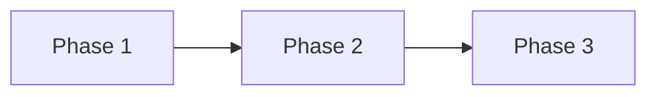

# DEV-PLAN 输出模板

本模板用于生成分阶段开发计划。dev-builder 读取此文档按 Phase 逐步实现代码。

---

## 模板结构

**文件命名**：DEV-PLAN.md

---

```markdown
# Development Plan — [项目名称]

> 本文件记录项目的开发阶段划分、当前进度和剩余工作。
> 新 session 启动时应首先阅读此文件，了解项目状态后再继续开发。

---

## Phase 1: [功能名称]

**关联需求**：REQ-001 / AC-001-01 / AC-001-02
**依赖**：无 / Phase 0（[说明依赖什么]）

**交付内容**：
- [用动词开头，描述交付物1——用户能做什么 / 系统做什么]
- [交付物2]
- [交付物3]

**关键文件**：
- `src/path/to/file1.tsx` — [用途说明]
- `src/path/to/file2.ts` — [用途说明]
- `src/path/to/file3.ts` — [用途说明]

**验收标准**：
- [能编译、能启动、能看到 XX 效果]

**验证证据**：
- [测试命令 / 演示路径 / 截图或日志]

### DT-001 · [技术任务名]

**关联需求**：AC-001-01 / AC-001-02
**设计引用**：SCREEN-001 / CMP-001（无 UI 标 N/A）
**前置依赖**：DT-000 / 无
**涉及模块**：[Technical Design 中的模块名]
**产出**：[这个任务具体产出什么]
**关键文件**：`src/path/to/file1.tsx`
**完成判据**：[可验证的完成条件，对应 AC；UI 任务需含交互与状态]
**验证命令**：`[测试或构建命令]`

### DT-002 · [技术任务名]

**关联需求**：AC-001-03
**前置依赖**：DT-001
**产出**：[产出]
**关键文件**：[文件路径]
**完成判据**：[完成条件]
**验证命令**：[命令]

---

## Phase 2: [功能名称]

**关联需求**：REQ-002 / AC-002-01

**交付内容**：
- [交付物列表]

**关键文件**：
- [文件路径 + 用途]

**验收标准**：
- [验证标准]

### DT-003 · [技术任务名]

**关联需求**：AC-002-01
**产出**：[产出]
**关键文件**：[文件路径]
**完成判据**：[完成条件]

---

<根据实际功能数量动态增减 Phase / DT>

---

## 技术设计摘要（来自 Technical-Design.md）

> 无 Technical-Design.md 时整段标「设计降级：按 Spec + 工程约束实现」，并说明风险；新项目不允许降级。

| 项 | 内容 | 来源 |
|---|---|---|
| 架构模式 | [单体 / 模块化单体 / 微服务 / 事件驱动] | Technical-Design.md §2 |
| 模块边界 | [模块 A：职责；模块 B：职责] | §2 |
| 领域模型 | [核心聚合与不变量] | §4 |
| 数据设计 | [表、约束、索引、事务的要点] | §5 |
| API Contract | [openapi.yaml 路径 / 端点范围] | §6 |
| 关键 ADR | [ADR-001：结论；ADR-002：结论] | §3 |

## 技术栈

| 层级 | 技术 | 版本 | 说明 |
|------|------|------|------|
| [层级名] | [技术名] | [版本号] | [选择理由或用途] |

## 数据库表

| 表名 | 所属 Phase | 用途 | 关键约束 / 索引 |
|------|-----------|------|----------------|
| `table_name` | Phase N | [用途说明] | [PK / FK / UNIQUE / 索引] |

## 设计与技术输入

| 输入 | 页面 / 模块 | 组件 / 契约 | 实现 DT | 状态覆盖 |
|---|---|---|---|---|
| Design-Brief | SCREEN-001 | CMP-001 / CMP-003 | DT-00X | Loading / Empty / Error / Success |
| Technical-Design | [模块名] | [ADR / API 端点] | DT-00X | [验证方式] |

> 无 Design-Brief 时标「设计降级」并说明影响；新项目无 Technical-Design 视为阻塞，先回 dev-planner 技术设计。

## 任务层级与并行

**层级**：Phase = 可独立验收的交付边界；DT = 可独立完成与验证的任务；DT 内用 checklist 列子步骤，不额外造编号。

**依赖图**：



**可并行**：[哪些 DT 互不依赖，可分给不同人 / 子 Agent 同时做]
**关键路径**：[决定整体进度的 DT 序列]

## 开发规则

- 每完成一个 Phase 执行四步走：Code Review → 测试完整性 → 编译验证 → 功能测试
- 四步走全部通过后才能 commit
- Commit message 用 feat、fix、refactor、chore 前缀
- 包管理器：[pnpm/npm/yarn]
```

---

## 写作要点

1. **Phase 命名**：用功能名称命名，不用光秃秃的编号。“聊天核心 + SQLite 持久化”比“Phase 2”更容易理解。
2. **交付内容**：
   - 用动词开头：搭建、实现、创建、配置。
   - 每条描述一个可感知的交付物。
   - 基础设施 Phase 可以写“XX 表 + CRUD API”。
   - 业务功能 Phase 要写用户能做什么。
3. **关键文件**：
   - 使用完整的项目内相对路径。
   - 每个文件附用途说明。
   - 不列测试文件和配置文件，除非它是 Phase 的核心交付物。
4. **开发任务 DT**：
   - 每个 Phase 拆成 1~N 个 `DT-###`，编号全局唯一、只增不改。
   - 每个 DT 必须写 `**关联需求**：`，指向 Product-Spec 里真实存在的 REQ / AC。
   - 一个 AC 可以被多个 DT 覆盖；一个 DT 也可以覆盖多个 AC。
   - 没有 REQ 的任务（纯重构/基建）标 `关联需求：无（原因）`，由 `check_traceability.py` 记为警告。
5. **验收标准**：
   - 最低要求：能编译 + 能启动 + 新功能可用。
   - 推荐加上：现有功能未破坏。
   - P0 AC 必须能指向具体测试 ID。
6. **技术设计摘要**：
   - 架构模式、模块边界、领域模型、数据设计、API Contract、关键 ADR 逐项摘自 Technical-Design.md，不在这里重新论证。
   - 架构或接口未定，先回 workflow-technical-design.md，不在计划里写「待定」。
7. **技术栈表**：
   - 标注版本号，经 WebSearch 验证的最新稳定版。
   - 说明列写选择理由或用途；与 ADR 结论保持一致。
8. **数据库表**：
   - 标注在哪个 Phase 创建，并列出关键约束与索引。
   - 后续 Phase 新增列时，在该 Phase 的交付内容里说明这次 migration。
9. **Phase 顺序**：
   - 基础设施先行：骨架、数据库、路由 → 核心功能 → 辅助功能 → 收尾如 i18n、打包、部署。
   - 不违反依赖关系；Phase 头写清依赖与验证证据。
10. **任务字段**：
    - DT 必须写前置依赖、涉及模块、验证命令；没有依赖写「无」。
    - 验证命令要能直接执行，不写「手动检查」。
11. **并行**：
    - 依赖图里的可并行 DT 明确列出；关键路径单独标出。
    - 并行任务之间不得共享同一文件或同一接口变更。
12. **设计引用**：
    - 含 UI 的 DT 必须写 SCREEN / CMP 编号，并指向 Design-Brief 中真实存在的条目。
    - 前端 DT 的完成判据覆盖 Loading / Empty / Error / Success / Submitting，不只写"页面能用"。
    - 无 Design-Brief 或页面未覆盖时标「设计降级」，不静默跳过。
