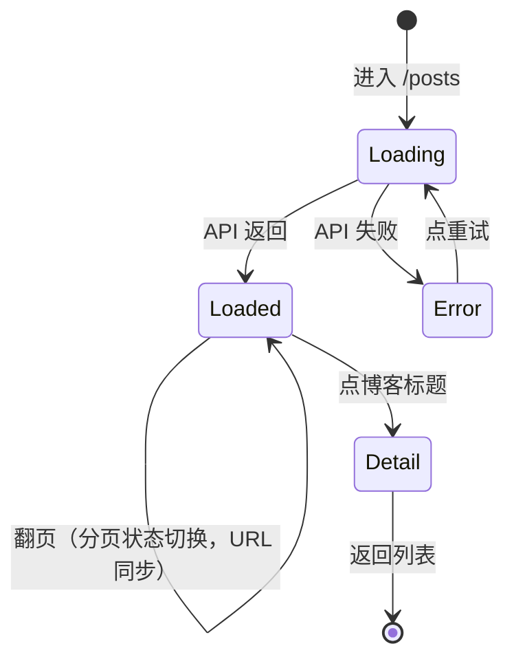
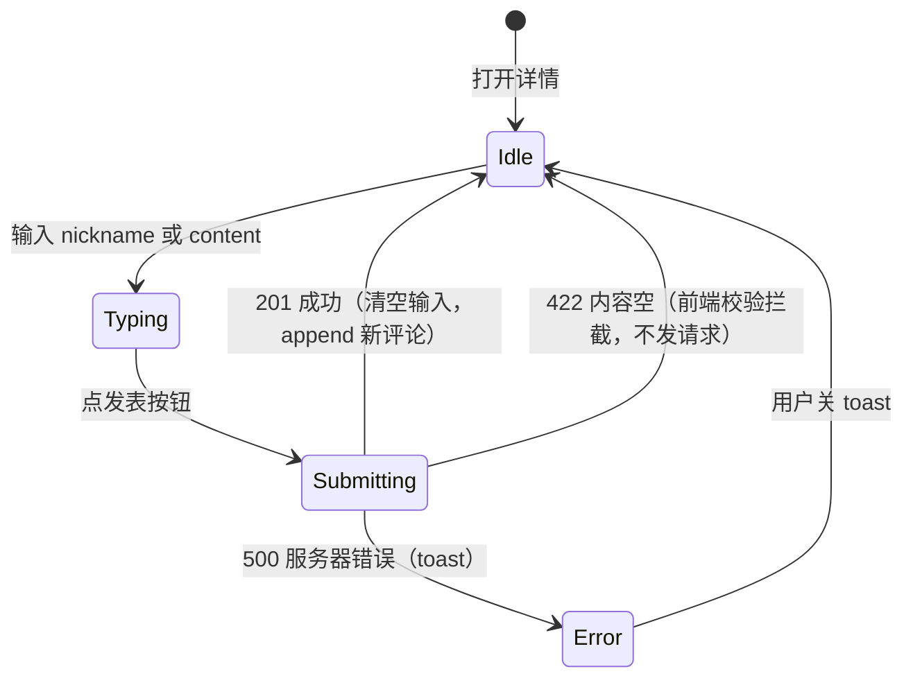
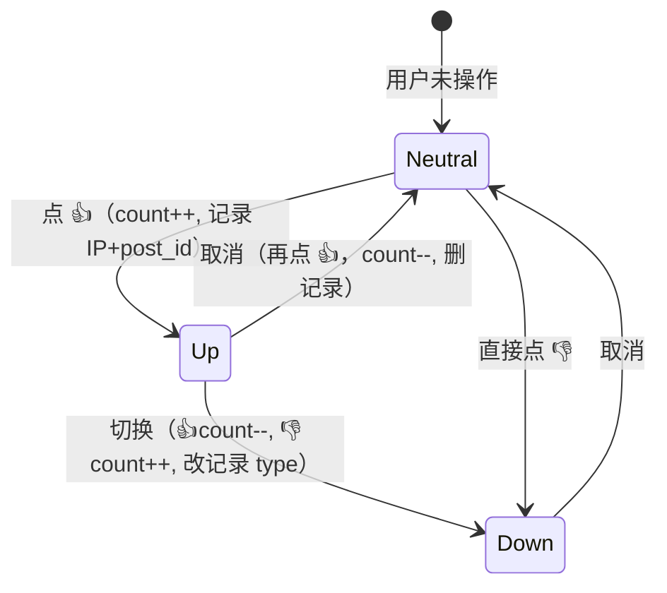

# Design Brief — Personal Blog MVP

> 按 IdeaHammer `design-brief-builder` 产出（无设计稿场景）
> 视觉策略：**沿用 Element Plus 复用**，不做新组件

---

## 1. 设计方向

### 1.1 目标用户

| 角色 | 使用情境 | 最关注 | 最怕 |
|---|---|---|---|
| 作者（author） | 本机或自托管环境，桌面浏览器，发布与维护阶段 | 写作表单够直接、置顶与删除操作明确 | 误删文章、管理入口暴露到公网 |
| 访客（读者） | 从文章链接进入，桌面或手机浏览器，阅读阶段 | 正文可读、评论与点赞即时生效 | 点了没反馈、重复提交、内容加载不出来 |

### 1.2 设计原则（按优先级）

1. **UI 一律以 Spec 为准**（无设计稿，继承 Element Plus 复用模式）
2. **3 分钟上手**：访客 3 分钟内能完成"看列表 → 看详情 → 评论 + 点赞"
3. **作者后台仅本机演示**：v0 无登录，页面显式警示；v1 加 token / 登录
4. **零认知负担**：作者不学 Markdown（v1），直接 textarea 写；访客不学 emoji

---

## 2. 路由信息架构

### 2.0 Persona

| 角色 | 在这个产品里要完成的任务 | 关注点 | 最常走的路径 |
|---|---|---|---|
| 作者 | 发布 / 编辑 / 置顶 / 删除文章 | 操作确认与保存反馈 | `/admin` → 新建 / 编辑 → 保存 → 回列表 |
| 访客 | 看列表 → 读详情 → 评论 / 点赞 | 阅读体验与即时反馈 | `/` → `/posts/:id` → 评论或点赞 |

### 2.1 路由清单

```text
/                       首页（最新博客列表，置顶在前）
/posts                  列表页（分页）
/posts/:id              详情页（评论 + 点赞 + 点踩）
/admin                  管理后台（v0 仅本机演示，无鉴权）
/admin/new              写博客
/admin/posts/:id/edit   编辑博客
```

### 2.2 关键页面线框（Wireframe）

| 线框要素 | 列表页 | 详情页 |
|---|---|---|
| 布局 | 单列卡片流 + 底部分页 | 正文主列 + 评论 / 反应区纵向排列 |
| 内容区域 | 标题、摘要、评论数、点赞数、时间 | 标题、元信息、正文、反应栏、评论列表、输入区 |
| 信息层级 | 标题 > 摘要 > 互动计数 > 时间 | 正文 > 反应 > 评论 > 输入 |
| 操作入口 | 卡片标题进入详情；底部分页 | 主操作：发表评论；次操作：点赞 / 点踩 |
| 页面关系 | 从导航或根路径进入，进入详情页 | 从列表进入，返回列表 |

**列表页**：

```
┌──────────────────────────────────────┐
│ [📌 置顶] 我的 IdeaHammer 实战        │  ← is_pinned=true, 红色背景
│ 摘要 · 评论 12 · 👍 30 👎 2 · 2h ago  │
├──────────────────────────────────────┤
│ 从一句话需求到可执行 Spec                 │
│ 摘要 · 评论 3 · 👍 8 👎 0 · 1d ago   │
├──────────────────────────────────────┤
│ 行业标杆参考：三个博客产品拆解            │
│ 摘要 · 评论 0 · 👍 1 👎 0 · 2d ago   │
└──────────────────────────────────────┘
              [上一页] 1 / 3 [下一页]
```

**详情页**：

```
┌──────────────────────────────────────┐
│ 从一句话需求到可执行 Spec                 │
│ 发布于 2026-09-29 · 评论 3 · 👍 8    │
├──────────────────────────────────────┤
│ 内容正文 ...                          │
├──────────────────────────────────────┤
│ [👍 8]  [👎 0]   ← 点击切换          │
├──────────────────────────────────────┤
│ 💬 评论 (3)                           │
│   ─ alice: 666                       │
│   ─ bob:  学到了                     │
│   ─ carol: 追问 pre-mortem           │
├──────────────────────────────────────┤
│ [nickname:_____] [content:_______]   │
│                              [发表]   │
└──────────────────────────────────────┘
```

---

### 2.3 需求映射（设计层追踪）

| 页面编号 | 路由 / 页面 | 覆盖 REQ | 关键交互 |
|---|---|---|---|
| SCREEN-001 | `/` 首页 | REQ-002 | 列表 + 分页 + 置顶排序 |
| SCREEN-002 | `/posts` 列表页 | REQ-002 | 分页 |
| SCREEN-003 | `/posts/:id` 详情页 | REQ-002 / REQ-003 / REQ-004 | 阅读 + 评论 + 点赞 |
| SCREEN-004 | `/admin` 管理后台 | REQ-001 / REQ-005 | 管理入口 + 置顶 |
| SCREEN-005 | `/admin/new` 写博客 | REQ-001 | 创建 |
| SCREEN-006 | `/admin/posts/:id/edit` 编辑博客 | REQ-001 | 编辑 |

### 2.4 用户流程（User Flow）

#### FLOW-001: 访客写评论（对应 Spec FLOW-001）

| 项 | 内容 |
|---|---|
| 入口 | 从列表页点标题进入详情页；滚动到「💬 评论 (n)」下方输入区 |
| 每步所需信息 | 1) 昵称输入框，placeholder「昵称」；2) 评论输入框，placeholder「说点什么」；3) 发表按钮 |
| 分支 | 内容为空或昵称为空 → 前端拦截并提示，不发请求；内容超 5000 字 → 前端提示长度上限 |
| 失败处理 | 422 → toast 显示字段错误，保留输入；500 / 网络失败 → toast「发送失败，请重试」，输入不清空 |
| 二次确认 | 无（评论可删除，不涉及不可逆操作） |
| 完成态 | 新评论出现在列表顶部，输入框清空，评论计数 +1 |

#### FLOW-002: 作者发布文章（对应 REQ-001 / TASK-001）

| 项 | 内容 |
|---|---|
| 入口 | 顶部导航「管理」 → `/admin` → 「新建」按钮 |
| 每步所需信息 | 标题输入框（必填，≤ 200 字）；正文 textarea（必填，≤ 100,000 字）；保存按钮 |
| 分支 | 标题或正文为空 → 保存按钮禁用并提示；保存成功 → 回列表；保存失败 → 停留并保留内容 |
| 失败处理 | 422 → 字段级提示；500 / 网络失败 → toast「保存失败，请重试」，内容不丢 |
| 二次确认 | 删除文章需二次确认（不可恢复）；置顶 / 取消置顶无需确认 |
| 完成态 | 列表出现新文章；置顶文章排在最前 |

---

## 3. 状态机

### 3.1 博客列表状态机



### 3.2 评论交互状态机



### 3.3 点赞状态机（防重复）



---

## 4. 反 UI 假设（明确拒绝的方案）

### 4.1 ❌ 反假设 1：评论要分页

错：博客评论 90% < 10 条，分页只是给读者找麻烦。

**正确**：评论一次性全加载（v0），> 50 条考虑分页。

### 4.2 ❌ 反假设 2：博客正文要支持富文本编辑器

错：富文本编辑器 = 200KB + 复杂状态 + XSS 风险。

**正确**：v0 用 textarea 写纯文本（存原文），v1 再引入 markdown-it + DOMPurify。

### 4.3 ❌ 反假设 3：点赞要带动画

错：动画分散阅读注意力，且开发成本不低。

**正确**：数字直接 +1/-1，无动画。

### 4.4 ❌ 反假设 4：管理后台要登录

错：MVP 单用户，加登录 = 2 表 + JWT + 找回密码 = 翻倍工作量。

**正确**：v0 管理端仅本机演示、无鉴权（页面警示勿暴露公网）；
v1 再加简单密码登录 / token。

---

## 5. 数据模型（与 Spec §6 对应）

```sql
-- posts 博客
CREATE TABLE posts (
    id INTEGER PRIMARY KEY AUTOINCREMENT,
    title TEXT NOT NULL,
    slug TEXT UNIQUE NOT NULL,  -- 自动从 title 生成，URL 用
    content TEXT NOT NULL,
    is_pinned BOOLEAN DEFAULT 0,
    created_at DATETIME DEFAULT CURRENT_TIMESTAMP,
    updated_at DATETIME DEFAULT CURRENT_TIMESTAMP
);
CREATE INDEX idx_posts_pinned ON posts(is_pinned DESC, created_at DESC);

-- comments 评论
CREATE TABLE comments (
    id INTEGER PRIMARY KEY AUTOINCREMENT,
    post_id INTEGER NOT NULL REFERENCES posts(id) ON DELETE CASCADE,
    nickname TEXT NOT NULL,
    content TEXT NOT NULL,
    created_at DATETIME DEFAULT CURRENT_TIMESTAMP
);
CREATE INDEX idx_comments_post ON comments(post_id, created_at);

-- reactions 点赞/点踩
CREATE TABLE reactions (
    id INTEGER PRIMARY KEY AUTOINCREMENT,
    post_id INTEGER NOT NULL REFERENCES posts(id) ON DELETE CASCADE,
    ip TEXT NOT NULL,           -- v0 简化：仅按 IP 防重复
    type TEXT NOT NULL CHECK(type IN ('up', 'down')),
    created_at DATETIME DEFAULT CURRENT_TIMESTAMP,
    UNIQUE(post_id, ip)         -- 同 IP 同博客只能 1 条
);
CREATE INDEX idx_reactions_post ON reactions(post_id, type);
```

**版本化**：本应用无业务数据变更（不是价格/规格/规则），v0 不引入 versioning-and-immutability（参考 `_engineering-constraints/database/versioning-and-immutability.md` 的判定标准）。

---

## 6. 视觉规范（沿用 Element Plus）

### 6.1 Design Tokens（语义变量 → Element Plus 映射）

| Token | 值 / 来源 | 前端映射 |
|---|---|---|
| color.background | 白 / 浅灰 | `var(--el-bg-color)` |
| color.surface | 卡片背景 | `var(--el-bg-color-overlay)` |
| color.primary | 品牌蓝 | `var(--el-color-primary)` |
| color.danger | 置顶 / 删除 | `var(--el-color-danger)` |
| color.text.primary | 正文 | `var(--el-text-color-primary)` |
| color.text.secondary | 辅助信息 | `var(--el-text-color-secondary)` |
| color.border | 分割线 | `var(--el-border-color)` |
| space.sm / md / lg | 8 / 16 / 24px | 组件 gap / padding |
| radius.sm / md | 4 / 8px | `var(--el-border-radius-base)` |
| shadow.sm | 卡片悬浮 | `var(--el-box-shadow-light)` |
| font.body | 14px / 1.6 | `--el-font-size-base` |

### 6.2 组件清单

| 组件编号 | 组件 | 选型 | 变体 | 状态覆盖 | 使用页面 |
|---|---|---|---|---|---|
| CMP-001 | Button | `el-button` | 主 / 默认 / 危险 / 文字 | default / hover / active / focus / disabled / loading | 全部 |
| CMP-002 | Status Badge | `el-tag` | 危险（置顶）/ 中性 | 静态 | 列表、详情 |
| CMP-003 | Input | `el-input` | 单行 / 多行 | default / focus / filled / error / disabled | 详情、编辑 |
| CMP-004 | Table | `el-table` | 基础 / 可排序 | default / loading / empty / error / 行禁用 | 管理后台 |
| CMP-005 | Pagination | `el-pagination` | 基础 | default / disabled | 列表 |
| CMP-006 | Toast | `ElMessage` | success / error | 静态 | 全部 |

### 6.3 组件选型

| 元素 | 选型 |
|------|------|
| 列表项 | `el-card` + 标题 `h3` + meta `h4` 灰色 |
| 置顶标识 | `el-tag type="danger"` 显示 `📌 置顶` |
| 点赞 / 点踩 | `el-button` + emoji + count；切换用 `el-radio-group` 或两个独立 button |
| 评论输入 | `el-input` + `el-button type="primary"` 发表 |
| 分页 | `el-pagination` |
| 管理后台 | `el-table` + `el-button` 编辑 / 删除 |
| 写博客 | `el-input` title + `el-input type="textarea" rows=20` content |
| Toast | `ElMessage.success/error` |

**理由**：Element Plus 复用策略（参考 flashcards 项目先例），不造新组件。

---

## 7. API 错误响应（统一）

| 状态码 | 含义 | 何时触发 |
|--------|------|---------|
| 200 | 成功 | 正常 GET / PUT / PATCH |
| 201 | 创建成功 | POST |
| 204 | 删除成功 | DELETE |
| 404 | 资源不存在 | GET / PUT / DELETE 不存在 id |
| 422 | 入参校验失败 | Pydantic 拦截 |
| 500 | 服务器错误 | DB / 异常 |

---

## 8. 可访问性与响应式

### 8.1 可访问性

- 所有按钮 `aria-label`
- 键盘可达：`Tab` + `Enter` 发评论，`1/2` 切换点赞点踩
- 图标按钮（点赞 / 点踩）有可读文案，不只靠 emoji
- 错误提示与对应字段关联，状态不只靠颜色区分

### 8.2 响应式规则

| 断点 | 规则 |
|---|---|
| 移动端（< 768px） | 卡片单列；管理后台表格横向滚动；按钮触控高度 ≥ 40px |
| 平板端（768–1023px） | 卡片单列，正文最大宽度 720px |
| 桌面端（≥ 1024px） | 内容居中，最大宽度 840px；管理后台表格全列展示 |

### 8.3 i18n

- 文案中文（v0 不做 i18n）

---

## 9. 页面状态矩阵（八态）

| 页面 | 正常 | Loading | Empty | Error | Disabled | 无权限 | Submitting | Success |
|---|---|---|---|---|---|---|---|---|
| 列表页 | 卡片列表 + 分页 | 骨架卡片 | 「还没有文章」+ 管理入口 | 错误提示 + 重试 | N/A | N/A | N/A | N/A |
| 详情页 | 正文 + 评论 + 反应 | 正文骨架 | 评论空态「还没有评论」 | 错误提示 + 返回列表 | 空内容时发表按钮禁用 | N/A | 发表按钮 loading | 新评论置顶 + toast |
| 管理后台 | 表格 + 操作按钮 | 表格 loading | 「还没有文章」+ 新建 | 错误提示 + 重试 | 删除中行禁用 | N/A | 操作按钮 loading | toast + 表格刷新 |
| 写博客 | 空表单 | N/A | N/A | 校验错误提示 | 标题或正文为空时保存禁用 | N/A | 保存按钮 loading | 回列表 + toast |

> 管理端 v0 无鉴权，无「无权限」态；公网部署前必须补 v1 登录，该列为将来态。

---

## 10. Handoff 交付物

| # | 交付物 | 本产品对应 |
|---|---|---|
| 1 | 设计稿 | 无设计稿：以本文线框 + Element Plus 组件为准（降级说明） |
| 2 | Design Tokens | §6.1 |
| 3 | Component Inventory | §6.2 |
| 4 | Interaction Spec | §2.4 用户流程 + §3 状态机 + §7 API 错误响应 |
| 5 | Page State | §9 页面状态矩阵 |
| 6 | Asset Manifest | 图标使用 emoji（📌 / 👍 / 👎 / 💬），无外部图片与自定义字体 |
| 7 | Responsive Rules | §8.2 |

---

## 11. 视觉验收

| 类别 | 检查项 | 验收口径 |
|---|---|---|
| Visual QA | 卡片间距、标题层级、置顶标签样式、按钮变体一致 | 对照 §6.1 Token 与 §6.2 组件清单 |
| Interaction QA | 发表评论 loading 与防重复、点赞切换、删除确认、错误 toast | 对照 §2.4 与 §3 |
| Responsive QA | 列表单列、表格横向滚动、触控尺寸 | 对照 §8.2 |
| Accessibility QA | 键盘操作、焦点可见、aria-label、对比度 | 对照 §8.1 |

---

<!-- owner: design -->