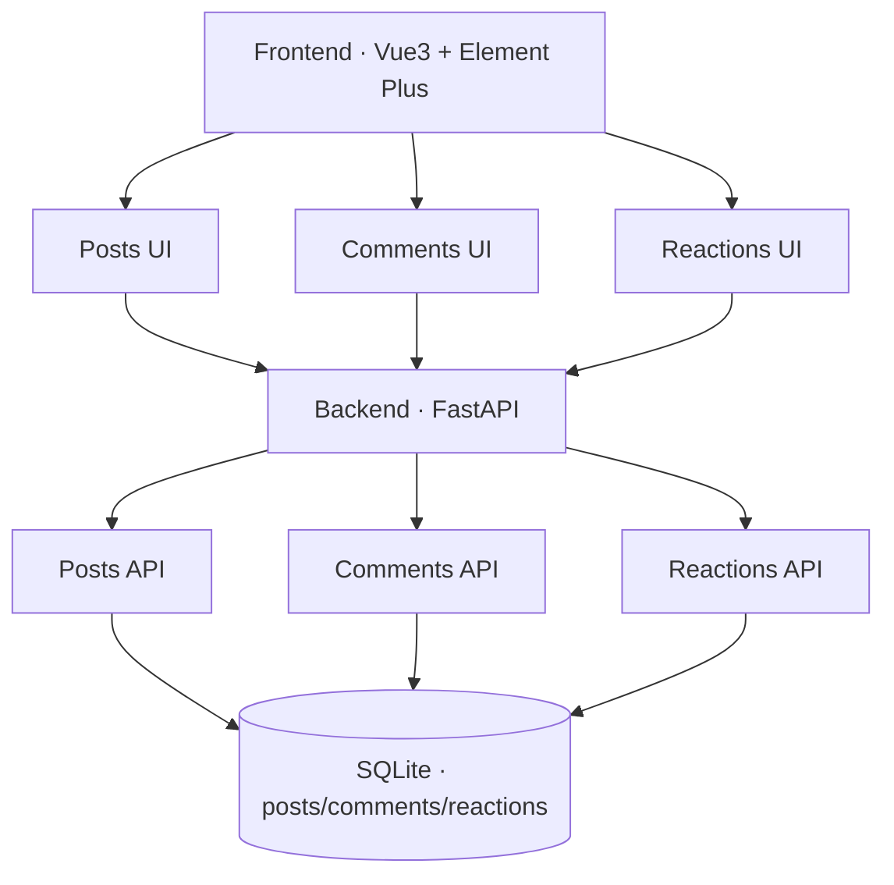

# 产品需求规范：Personal Blog（个人博客 MVP）

> 锚定 demo：`examples/personal-blog/`（按方法论从零到一真跑，非后补演示）
> 按 IdeaHammer 8 步流水线 **product-spec-builder** 产出，按需求工程五层（PRD → FRD → User Story → AC → Spec）组织

---

## 文档元信息

| 字段 | 值 |
|---|---|
| 当前版本 | v1.0.0 |
| 核心干系人 | 产品：wuzhilong，研发：AI IDE + 个人 |
| 版本内容 | MVP 9 端点 + Vue3 前端 + 评论 + 点赞点踩 + 置顶，演示 IdeaHammer 方法论的活工程 |
| 版本日期 | 2026-09-16 |
| 评审记录 | wuzhilong 2026-11-25 读回确认；遗留：管理端 v0 无鉴权（见 OUT-007） |

---

## 0. AI 使用说明

- 本文档是产品功能、范围、行为和验收标准的事实来源。
- AI MUST 优先实现 P0。
- AI MUST NOT 实现"不在本版本范围"中明确排除的内容。
- AI MUST 根据"验收标准"判断功能是否完成。
- 如果信息不明确，AI MUST 使用"假设"中的假设；如果仍无法判断，应记录到"待确认问题"，而不是自行扩展需求。

---

## 0.5 产品类型（驱动标杆参考与范围权重）

| 字段 | 值 |
|---|---|
| 项目类型 | `业务参照型` |
| 判断依据 | 个人博客赛道属于公司既有"内容产出"业务线，问题域成熟（Hexo/Hugo/Halo/WordPress），重心在 §1.8 行业借鉴；产品本身不是"新市场机会型"产品，价值在于演示方法论如何落地 |

---

## 需求工程五层（本文档的组织方式）

| 层 | 回答什么问题 | 本文档对应位置 |
|---|---|---|
| 1. PRD | 为什么做、为谁做、提供什么价值 | §1–§4 |
| 2. FRD | 每个功能具体应该怎么工作 | §5 每个 REQ 的行为 / 规则 / 输入输出 / 状态 |
| 3. User Story | 用「作为…我希望…以便于…」表达需求，不是独立文档 | §5 每个 REQ 的用户故事 |
| 4. AC | 判断 User Story 或功能需求是否完成的可验证条件 | §5 每个 REQ 的验收标准（AC-###-##） |
| 5. Spec | 把以上内容组织成可执行的规格 | 全文 + 编号体系 + §9 完成定义 |

> 五层不是五份文档：PRD 与 FRD 是文档内容，User Story 与 AC 是表达与验收方式，Spec 是最终组织形态。

---

## 1. PRD：产品背景与用户

### 1.1 产品背景与目标

- **背景**：有想法、有经验的作者需要自持内容资产；主流静态方案缺评论与后台，平台方案锁定内容、迁移困难
- **业务问题**：作者要在静态站、评论系统、管理后台之间手工拼装，单次发布耗时 1–2 天，二开成本高
- **为什么现在**：方法论需要可运行案例支撑，仓库现有文档无法证明"Spec → 测试 → 追踪"链路真的跑得通
- **投入与替代**：约 3 人天；替代方案是 Hexo + 第三方评论，省事但放弃后台与链路演示，与本项目目标不符
- **是什么**：演示 IdeaHammer 方法论的活工程博客（FastAPI + Vue3 全栈）
- **为什么**：给读者 3 分钟可验证的"AI Coding 真落地"完整案例
- **怎么做**：9 端点 REST + SQLite + Vue3 前端，读 Spec / DEV-PLAN / 测试 / 审查 / 追踪产物可见全过程
- **目标**：v0 跑通"作者发布 → 访客阅读 / 评论 / 点赞"闭环，全链路测试与追踪可校验

### 1.2 用户角色与画像

| 用户类型 | 画像（是谁 / 场景 / 现有习惯） | 核心需求 |
|---|---|---|
| 作者（author） | 有想法、有经验、有作品的独立作者（工程师 / 开发者），长期写作、习惯 Markdown 与 Git，把博客当作可自持的长期作品资产 | 快速发布 Markdown 文章、置顶代表作、接收读者反馈 |
| 访客（读者） | 关注技术内容与作品的读者，从文章链接进入，偶尔留言或点赞 | 阅读文章 + 评论 + 点赞反馈 |

### 1.3 用户核心问题

有想法、有经验、有作品的作者需要把文章沉淀为可自持的长期资产，并直接收到读者反馈；但主流方案（Hexo/Hugo 静态、Notion 平台化）要么无评论/无后台，要么内容被平台锁定、迁移困难。缺少「写作 + 反馈」一体化、内容自持的轻量博客方案。

### 1.4 核心价值

把博客作为方法论演示的活工程（不是营销页），让读者能在 3 分钟内看到"这套流水线真能把 AI Coding 落地"。方法论价值 > 产品功能价值。

### 1.5 系统功能架构



### 1.6 业务指标

| 指标 | 定义 / 计算口径 | 目标 | 观察信号 |
|---|---|---|---|
| 发布闭环可用 | 作者发布 → 访客可读的端到端流程通过率 | 100%（9 端点全部可用） | 任一端点 404 / 500 即不达标 |
| 上手成本 | clone → install → run 的耗时 | ≤ 5 分钟 | 新读者首次运行超过 5 分钟 |
| 演示可追溯 | P0 需求具备 DT / TEST / 版本关联的比例 | 100%（`check_traceability --strict` 0 警告） | 出现未关联 REQ 的缺口 |

### 1.7 行业标杆参考（≥ 2 同类产品 + ≥ 2 替代方案）

> 目的不是判断"我们凭什么赢"，而是看清别人怎么把博客做出来：哪些机制能直接对上我们的需求、哪些要改、哪块必须自己设计。

| 类型 | 名字 | 解决什么 | 它的做法（关键机制） | 契合点（对应 REQ / SCOPE） | 需定制点 | 原创点 |
|---|---|---|---|---|---|---|
| 同类产品 | Hexo / Hugo / Astro / VuePress | 静态博客生成器 | 本地构建静态页，内容走 Git，评论靠第三方（Gitalk / Disqus） | 阅读体验与 Markdown 写作流（REQ-001） | 需自建评论与后台，不能直接复用静态生成 | 评论 + 点赞 + 后台一体化（SCOPE-006~009） |
| 同类产品 | Halo 2.x | 动态博客（Java + Vue3） | Docker 部署，插件扩展，后台管理 + 主题体系 | 后台管理与评论模型（REQ-003、REQ-005） | Java 栈重、后台 UI 复杂，改为轻量 FastAPI + 最小管理页 | 3 分钟跑通的上手路径（业务指标"上手成本"） |
| 同类产品 | WordPress | PHP 动态博客 | 插件生态 + 主题 + 后台管理 | 置顶与评论管理（REQ-003、REQ-005、SCOPE-009） | 去掉插件/主题体系，只保留 P0 端点 | SQLite 零运维 + 单作者极简模型 |
| 替代方案 | Notion + Super.so | Notion 当后端，前端套壳 | 页面块存储 + 前端渲染 | 写作与即时预览体验（v1 参考） | 内容锁定、迁移难，改为自有数据模型 | 数据自持 + Markdown 导出（v1） |
| 替代方案 | 掘金 / 知乎 / 公众号 | 平台发布 | 平台流量分发 + 站内评论 | 评论互动形态（REQ-003） | 无法自定义域名与数据，改为自托管 | 自有域名 + 完全可控的内容资产 |
| 替代方案 | GitHub Issues + Pages | 极客方案 | issue 即评论，Pages 托管静态站 | 零成本评论（REQ-003） | 技术门槛高、无点赞 UI，改为站内原生评论 | 非技术读者也能留言（SCOPE-006） |

### 1.8 行业借鉴（≥ 2 顶级品类优秀做法）

| 来源产品/品类 | 借鉴维度 | 它的做法 | 我们怎么用 | 借鉴后的差异化风险 |
|---|---|---|---|---|
| 静态博客（Hexo/Hugo） | 工程 | 纯静态、零运维、Git 驱动内容 | 后端虽为动态，但写博客/版本管理走 Git 思维（commit 即版本） | 丢掉"动态评论/动态估值"——这是差异化主轴，不算风险 |
| Halo 2.x | 增长 | Docker 一键部署，README 一段命令跑通 | 个人博客 README 写明 `uv run uvicorn` 一行命令跑通 | 后台 UI 简化到最低限度，作者操作 = REST 直调 |
| Notion | 交互 | 块级编辑 + 即时预览 | v1 引入前端 markdown-it 实时预览（v0 不做） | v0 后端存原文不渲染，差异化保留到 v1 |
| Medium | 增长 | 点赞/鼓掌等轻量反馈 | 借鉴"轻量反馈"思路，做点赞 + 点踩两种反应而非单一打分 |

---

## 2. 功能范围（PRD）

> 本版本做什么、不做什么；优先级汇总见 §4。

### 2.1 本版本范围

| 编号 | 内容 | 优先级 | 备注 |
|---|---|---|---|
| SCOPE-001 | 发布博客（POST /api/posts） | P0 | 9 端点之一 |
| SCOPE-002 | 列表 + 分页 + 置顶优先（GET /api/posts） | P0 | |
| SCOPE-003 | 详情（GET /api/posts/{id_or_slug}） | P0 | 含评论数 + 点赞数派生 |
| SCOPE-004 | 编辑（PUT /api/posts/{id}） | P0 | |
| SCOPE-005 | 删除（DELETE /api/posts/{id}） | P0 | 硬删除 |
| SCOPE-006 | 写评论（POST /api/posts/{id}/comments） | P0 | FLOW-001 |
| SCOPE-007 | 点赞 / 点踩（POST /api/posts/{id}/react） | P0 | IP 唯一 |
| SCOPE-008 | 设置/取消置顶（PATCH /api/posts/{id}/pin） | P0 | |
| SCOPE-009 | 删除评论（DELETE /api/comments/{id}） | P1 | 后台管理 |

### 2.2 不在本版本范围

| 编号 | 内容 | 原因 |
|---|---|---|
| OUT-001 | 用户登录 / 注册 | v1：加 JWT 简单 token |
| OUT-002 | Markdown 渲染 | v1：前端 markdown-it |
| OUT-003 | 评论审核 / spam 防护 | v1 |
| OUT-004 | 标签 / 分类 / 搜索 | v1 |
| OUT-005 | SEO / RSS / sitemap | v1 |
| OUT-006 | 邮件通知 | 永远不做 |
| OUT-007 | 多用户 / 权限分级 | 永远不做（自用单作者） |

---

## 3. 核心业务流程（PRD）

### 3.1 用户任务（TASK）

| 编号 | 用户任务 | 用户类型 | 优先级 |
|---|---|---|---|
| TASK-001 | 发布一篇 Markdown 博客 | 作者 | P0 |
| TASK-002 | 浏览博客列表（含置顶优先） | 访客 | P0 |
| TASK-003 | 阅读单篇博客详情 | 访客 | P0 |
| TASK-004 | 编辑/删除自己的博客 | 作者 | P0 |
| TASK-005 | 在博客详情页写评论 | 访客 | P0 |
| TASK-006 | 对博客点赞或点踩 | 访客 | P0 |
| TASK-007 | 设置或取消博客置顶 | 作者 | P0 |
| TASK-008 | 删除不当评论（后台管理） | 作者 | P1 |

---

> 以下是端到端用户流程（FLOW），每个流程关联一个或多个 TASK。

### FLOW-001: 访客写评论（TASK-005）

**关联任务：** TASK-005
**优先级：** P0
**目标：** 让访客在博客详情页对内容表达反馈

**入口：** 访客在 `/posts/{id}` 详情页底部看到评论框

**主路径：**
1. 访客填写 nickname + content
2. 前端校验 content 非空 → 否则禁用提交
3. POST `/api/posts/{id}/comments`
4. 后端 Pydantic 校验（nickname/content 必填 + 长度）→ 否则 422
5. 入库 → 201 返回新评论对象
6. 前端刷新，新评论立刻显示在评论列表顶部

**流程图（Mermaid `graph TD`）：**
```mermaid
graph TD
    A[访客在博客详情页] --> B[填写 nickname + content]
    B --> C{内容非空?}
    C -->|否| D[前端禁提交 + toast]
    C -->|是| E[POST /api/posts/{id}/comments]
    E --> F{后端校验通过?}
    F -->|否| G[422 错误响应]
    F -->|是| H[201 + 新评论入库]
    H --> I[前端列表刷新 + 新评论置顶显示]
```

**分支路径：** 后端校验失败 → 显示字段级错误（前端 v1 实现；v0 仅 toast）

**边界情况：**
- nickname 为空 → 422
- content > 5000 字 → 422
- 评论提交后博客被删除 → 评论保留（孤儿评论，v1 异步清理）

**完成状态：** 用户看到新评论出现在列表顶部，数据库 comments 表新增一条

---

## 4. 产品优先级（PRD）

| 编号 | 内容 | 类型 | 优先级 | 理由 |
|---|---|---|---|---|
| SCOPE-001 ~ SCOPE-008 | 发布 / 列表 / 详情 / 编辑 / 删除 / 评论 / 反应 / 置顶 | 功能 | P0 | 构成"发布 → 阅读 → 反馈"闭环，缺一不可 |
| SCOPE-009 | 删除评论 | 功能 | P1 | 后台管理，v0 可由数据层直接处理 |
| REQ-001 | 博客 CRUD | 功能 | P0 | 内容生产的基础能力 |
| REQ-002 | 博客列表（置顶优先 + 分页） | 功能 | P0 | 访客进入后的第一入口 |
| REQ-003 | 评论 | 功能 | P0 | 核心反馈通道 |
| REQ-004 | 点赞 / 点踩 | 功能 | P0 | 轻量反馈，降低留言门槛 |
| REQ-005 | 置顶 | 功能 | P0 | 作者突出代表作 |

> 与 §2.1、§5 各 REQ 的「优先级」字段保持一致。

---

## 5. FRD：功能需求（REQ）

> FRD 层回答：每个功能具体应该怎么工作。每个 REQ 是一条功能需求，内含 User Story（表达方式）与 AC（验收标准）。

### REQ-001: 博客 CRUD

**优先级：** P0
**关联任务：** TASK-001 / TASK-004
**关联流程：** [待补充]

**用户故事（User Story）：**

- **作为一个** 作者，
- **我希望** 通过 REST 端点发布、编辑、删除博客，
- **以便于** 把文章沉淀为可自持的长期资产。

**目标：**
- **是什么**：作者对博客的发布/编辑/删除能力
- **为什么**：博客的核心写操作
- **怎么做**：REST 4 端点 + SQLite `posts` 表

**行为：** 作者通过 4 个 REST 端点操作博客（POST 创建、PUT 编辑、DELETE 删除、PATCH 置顶）。`is_pinned` 翻转由 PATCH 独立端点处理。

**规则：**
- MUST title 非空且 ≤ 200 字
- MUST slug 由 title 自动生成（kebab-case，去除非 ASCII），重复加 `-{id}` 后缀
- MUST 删除博客 = 硬删除（v0 简化，v1 改软删除）
- SHOULD content 长度 ≤ 100,000 字

**展示字段（页面渲染）：**

| 字段 | 类型 | 是否可编辑 | 说明 |
|---|---|:---:|---|
| id | int | No | 主键 |
| title | string | Yes | 标题 |
| content | markdown | Yes | 原文（v0 不渲染） |
| is_pinned | bool | Yes | 是否置顶 |
| created_at | datetime | No | 创建时间 |
| updated_at | datetime | No | 更新时间 |
| comment_count | int | No | 派生：评论数 |
| reaction_count | int | No | 派生：点赞数 - 点踩数 |

**输入：**

| 字段 | 类型 | 必填 | 校验规则 |
|---|---|---:|---|
| title | string | Yes | 1-200 字 |
| content | string | Yes | 1-100000 字 |
| is_pinned | bool | No | 默认 false |

**输出 / 结果：**
- 创建/修改返回完整 blog JSON
- 删除返回 204

**状态：** [待补充——纯展示类无状态切换]

**验收标准：**
- [ ] AC-001-01: Given title/content 合法, when POST /api/posts, then 201 且返回 id、slug、title、content、is_pinned。
- [ ] AC-001-02: Given title 或 content 为空, when 创建或编辑, then 返回 422。
- [ ] AC-001-03: Given 博客存在, when PUT 修改或 DELETE 删除, then 修改返回 200 新内容，删除返回 204 且后续 GET 返回 404。

### REQ-002: 博客列表（含置顶优先 + 分页）

**优先级：** P0
**关联任务：** TASK-002

**用户故事（User Story）：**

- **作为一个** 访客，
- **我希望** 在列表页按置顶与时间顺序浏览博客，
- **以便于** 快速找到代表作与最新内容。

**目标：**
- **是什么**：访客在列表页看到所有博客
- **怎么做**：`GET /api/posts?limit=&offset=` 返回按 `is_pinned DESC, created_at DESC` 排序

**行为：** 访客请求列表时，服务端按置顶优先、创建时间倒序排序后分页返回；请求详情时按 id 或 slug 读取，并聚合评论与反应计数。

**规则：**
- MUST limit 默认 20、上限 100；offset ≥ 0
- MUST 置顶博客始终排在非置顶之前
- SHOULD 列表不返回完整 content（摘要由前端截取）

**展示字段（页面渲染）：** 同 REQ-001 展示字段

**输入：**

| 字段 | 类型 | 必填 | 校验规则 |
|---|---|---:|---|
| limit | int | No | 1-100，默认 20 |
| offset | int | No | ≥0，默认 0 |

**输出 / 结果：**
- 列表：`{items, total, limit, offset}`，每条含 id / title / slug / is_pinned / created_at
- 详情：完整 content + comments + up_count / down_count

**状态：** 无状态切换（纯查询类）。

**验收标准：**
- [ ] AC-002-01: Given 存在置顶与非置顶博客, when GET /api/posts, then 置顶排最前。
- [ ] AC-002-02: Given 5 篇博客, when limit=2&offset=0, then 返回 2 条。
- [ ] AC-002-03: Given 博客存在, when 按 id 或 slug 查询, then 返回完整 content；id 不存在返回 404。
- [ ] AC-002-04: Given 博客有评论和点赞, when 查详情, then 返回 comments、up_count、down_count；无互动时 comments 为空数组、计数为 0。

### REQ-003: 评论

**优先级：** P0
**关联任务：** TASK-005 / TASK-008
**关联流程：** FLOW-001

**用户故事（User Story）：**

- **作为一个** 访客，
- **我希望** 在详情页写下评论并立刻看到它出现，
- **以便于** 直接和作者交流；作者也能删除不当评论，维护讨论质量。

**目标：**
- **是什么**：访客对博客写评论；作者可删除评论
- **怎么做**：`POST /api/posts/{id}/comments` + `DELETE /api/comments/{id}`

**规则：**
- MUST nickname 非空且 ≤ 50 字
- MUST content 非空且 ≤ 5000 字
- MUST 评论无审核流（v1 加 spam 防护）

**行为：** 访客提交评论时，服务端校验博客存在与字段合法后入库并返回 201；作者删除评论返回 204；博客删除时级联清除其评论。

**输出 / 结果：**
- 创建成功：201 + `{id, post_id, nickname, content}`
- 删除成功：204，无响应体

**输入：**

| 字段 | 类型 | 必填 | 校验规则 |
|---|---|---:|---|
| nickname | string | Yes | 1-50 字 |
| content | string | Yes | 1-5000 字 |

**状态流转（仅含状态切换的 REQ 必填，纯展示类可跳过）：**

| 状态 | 触发条件 | 异常分支 |
|---|---|---|
| 未评论 | 用户未提交评论 | — |
| 已提交 | POST 成功 201 | 入库失败 → 422 |

**验收标准：**
- [ ] AC-003-01: Given nickname/content 合法且博客存在, when POST 评论, then 201 且返回 id、post_id、nickname、content。
- [ ] AC-003-02: Given content 或 nickname 为空、或博客不存在, when POST 评论, then 分别返回 422 / 404。
- [ ] AC-003-03: Given 评论存在, when DELETE 评论, then 204；评论不存在返回 404；删除博客级联删除其评论。

### REQ-004: 点赞 / 点踩（Reactions）

**优先级：** P0
**关联任务：** TASK-006

**用户故事（User Story）：**

- **作为一个** 访客，
- **我希望** 用点赞或点踩表达态度，且重复点击不重复计数，
- **以便于** 用最低成本反馈内容质量。

**目标：**
- **是什么**：访客对博客的轻量反馈
- **怎么做**：`POST /api/posts/{id}/react` body `{type: "up"|"down"}`，按 IP+post_id 唯一索引防重复

**行为：** 服务端按 `X-Forwarded-For` 取客户端 IP，查 `(post_id, ip)` 唯一记录；不存在则新增，同 type 则跳过，type 不同则删旧增新，最后返回双边计数。

**规则：**
- MUST type 仅接受 up / down，其它值返回 422
- MUST 同 IP 同 type 不重复计数
- MUST 切换 type 时旧反应被替换

**输入：**

| 字段 | 类型 | 必填 | 校验规则 |
|---|---|---:|---|
| type | string | Yes | up / down |

**输出 / 结果：**
- 200 + `{post_id, up_count, down_count, my_reaction}`

**状态流转：**

| 状态 | 触发条件 | 异常分支 |
|---|---|---|
| 未反应 | 首次访问 | — |
| 已赞 | 同 IP POST type=up | 重复点赞计数不变（IP 唯一索引） |
| 已踩 | 同 IP POST type=down | 同上 |
| 取消 | 重复点击同一 type（v1 翻转语义） | v0 不实现 |

**派生计算（可选）：**
- `reaction_count = up_count - down_count`（派生展示字段）

**验收标准：**
- [ ] AC-004-01: Given 博客存在, when POST react type=up/down, then 返回 200 且对应 up_count / down_count 更新。
- [ ] AC-004-02: Given 同 IP 已点赞, when 再次点赞, then 计数不变；切换 type 时旧反应被替换。
- [ ] AC-004-03: Given 不同 IP 或非法 type 或不存在的博客, when react, then 不同 IP 累加、非法 type 返回 422、博客不存在返回 404。

### REQ-005: 置顶

**优先级：** P0
**关联任务：** TASK-007

**用户故事（User Story）：**

- **作为一个** 作者，
- **我希望** 设置或取消博客置顶，
- **以便于** 让代表作始终排在列表前面。

**目标：**
- **是什么**：作者标记代表作
- **为什么**：让代表作稳定占据列表头部
- **怎么做**：`PATCH /api/posts/{id}/pin` 翻转 `is_pinned`

**行为：** 作者对指定博客调用 PATCH，服务端校验博客存在后翻转 `is_pinned` 并返回最新状态。

**规则：**
- MUST `is_pinned` 为布尔值，缺省时按翻转处理
- MUST 博客不存在返回 404

**输入：**

| 字段 | 类型 | 必填 | 校验规则 |
|---|---|---:|---|
| is_pinned | bool | No | 默认 false |

**输出 / 结果：**
- 200 + `{id, is_pinned}`

**状态流转：**

| 状态 | 触发条件 | 异常分支 |
|---|---|---|
| 未置顶 | 创建时默认 | — |
| 已置顶 | PATCH /pin is_pinned=true | 同时只能 1 篇置顶（v0 不强制，v1 加唯一性约束） |

**验收标准：**
- [ ] AC-005-01: Given 博客未置顶, when PATCH /pin, then is_pinned 翻转为 true。
- [ ] AC-005-02: Given 博客已置顶, when 再次 PATCH /pin, then is_pinned 翻回 false。
- [ ] AC-005-03: Given 已置顶博客, when GET /api/posts, then 该博客排在所有非置顶博客之前。

---

## 6. 数据模型

### 6.1 核心实体

| 实体 | 描述 | 关键字段 |
|---|---|---|
| Post | 博客 | id, title, slug, content, is_pinned, created_at, updated_at |
| Comment | 评论 | id, post_id, nickname, content, created_at |
| Reaction | 点赞/点踩 | id, post_id, ip, type(up/down), created_at；UNIQUE(post_id, ip) |

### 6.2 实体关系

| 关系 | 描述 |
|---|---|
| Post has many Comment | 一篇博客可有多条评论 |
| Post has many Reaction | 一篇博客可有多个反应（按 IP 唯一） |

### 6.3 数据规则

- 创建：POST 时自动生成 slug（kebab-case 去非 ASCII，重复加 `-{id}`）
- 更新：编辑博客 = 全字段 UPDATE，updated_at 刷新
- 删除：博客 = 硬删除（评论/反应保留为孤儿，v1 异步清理）
- 权限：v0 无登录，所有 API 公开（自用单作者）

---

## 7. 外部依赖

| 编号 | 依赖 | 用途 | 是否必需 | 备注 |
|---|---|---|:---:|---|
| DEP-001 | FastAPI | Web 框架 | Yes | 后端核心 |
| DEP-002 | SQLAlchemy 2.0 | ORM | Yes | DB 访问 |
| DEP-003 | Pydantic v2 | 数据校验 | Yes | 入参/出参 |
| DEP-004 | SQLite | 数据库 | Yes | 单文件 DB，零运维 |
| DEP-005 | Vue 3.5 + Element Plus 2.8 | 前端框架 + UI 库 | Yes | 已交付 `frontend/`（Vite 构建 + Vitest） |
| DEP-006 | pytest + TestClient | 测试 | Yes | TDD |
| DEP-007 | uv | 包管理 | Yes | Python 项目管理 |
| DEP-008 | markdown-it + DOMPurify（v1） | Markdown 渲染 + XSS 防护 | No | v1 引入 |

---

## 8. 非功能需求

> 本产品 = 单机 / 单用户 / 自用 / 演示，并发与一致性显式"不要求"。

| 类别 | 要求 | 优先级 |
|---|---|---|
| 性能 | 列表查询 P99 < 100ms（100 篇博客内） | P1 |
| 安全 | 评论 nickname + content 用 Pydantic 校验防 SQL 注入 / XSS（v0 内容不渲染 HTML） | P0 |
| 隐私 | 无用户隐私数据收集（无登录、无 Cookie） | P1 |
| 并发与一致性 | 不要求（单机 SQLite 单进程，无联网服务） | P1 |
| 兼容性 | 后端 Python 3.11+；前端现代浏览器（Vue3 + Vite 构建） | P1 |
| 可靠性 | 无备份机制（v0 简化，作者手动 cp sqlite 文件） | P1 |
| 可访问性 | [待补充——v0 暂不要求] |

---

## 9. 完成定义

MVP 完成条件：

- [x] 所有 P0 requirements（REQ-001 ~ REQ-005）已实现
- [x] 所有 P0 acceptance criteria 已通过（后端 29 + 前端 10，共 39 个测试 GREEN）
- [x] 所有 P0 user flows（FLOW-001）可以端到端完成
- [x] 主要错误状态、空状态、加载状态已处理（422 / 404 / 204）
- [x] Product Spec 和 Design Spec 中的 P0 内容保持一致

### 9.1 出口判据：下游可执行

- [x] 每条 P0 REQ 都有 FRD 四件套：行为、规则、输入输出、状态
- [x] 每条 REQ 都有 ≥ 1 条用户故事 + ≥ 3 条 AC（主路径 / 边界 / 错误）
- [x] 范围有 P0 清单与 OUT 清单（§2.1 / §2.2）
- [x] §4 优先级与 §2、§5 的 P0 一致
- [x] 数据模型 / 外部依赖 / 非功能需求足以支撑建表、接依赖与验收
- [x] 所有未知项都有归属（§10.1 ASM / §10.2 Q）
- [x] 阻塞问题已清空
- [x] 自检：DEV-PLAN 已据此拆出 WI-1 ~ WI-11，无需回头再问产品

---

## 10. 假设与待确认问题

### 10.1 假设

| 编号 | 假设 | 假设依据 | 错误风险 |
|---|---|---|---|
| ASM-001 | 单作者自用，无登录鉴权 | wuzhilong 单人博客 | 多人用 = 互相删博客（v1 加 JWT） |
| ASM-002 | 评论无需审核流 | v1 加 spam 防护 | spam 灌满 → 关闭评论 |
| ASM-003 | Markdown 渲染放 v1 | v0 简化后端 | 读者看 raw markdown → 体验差（v1 加） |
| ASM-004 | 单文件 SQLite 可用至 1GB | 100 篇博客 < 1MB | 单文件 > 1GB → 性能崩（v1 迁 PG） |

### 10.2 待确认问题

| 编号 | 问题 | 是否阻塞 | 备注 |
|---|---|:---:|---|
| Q-001 | 是否需要 v0 即交付前端？ | No | 已交付：`frontend/`（Vue3 + Element Plus + Vite） |
| Q-002 | 标签/分类/搜索放 v0 还是 v1？ | No | 已明确 v1 |
| Q-003 | 是否需要备份 cron？ | No | 作者手动 cp 即可 |

---

<!-- owner: product -->