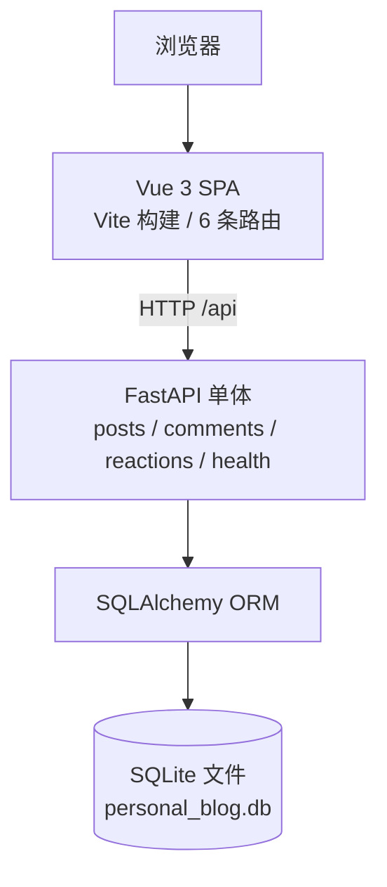

# Technical Design — Personal Blog MVP

> 按 IdeaHammer `dev-planner` 产出：先定架构、领域模型、数据设计与 API Contract，再由 DEV-PLAN 拆执行顺序。
> 本文只回答「怎么实现」。功能范围以 [Product-Spec.md](./Product-Spec.md) 为准，界面与状态以 [Design-Brief.md](./Design-Brief.md) 为准。

---

## 1. 系统概览与约束

### 1.1 输入

| 输入 | 内容 | 来源 |
|---|---|---|
| 功能范围 | 文章 CRUD、置顶、评论创建/删除、点赞点踩、管理端；不做登录、Markdown、评论审核、搜索、RSS | Product-Spec §2 |
| 非功能要求 | 单机演示可跑；列表与详情响应可感知地在 1s 内；写入不丢数据 | Product-Spec §6 |
| 核心数据 | Post、Comment、Reaction 三类实体及其关系 | Product-Spec §6 |
| 外部依赖 | 无第三方服务；仅 Python / Node 运行时 | Product-Spec §7 |
| 规模预期 | 单作者、单进程、数据量在千级；不做横向扩展 | Product-Spec §2.2 |
| 团队与交付 | 单人开发，前后端同仓，一条命令可跑测试 | 仓库约束 |

### 1.2 约束

- 技术栈固定为 FastAPI + SQLAlchemy + SQLite，前端 Vue 3 + Element Plus + Vite（Spec 已定，不重新选型）。
- 无外部数据库与缓存，部署形态为单机进程；不能引入需要独立运维的中间件。
- 数据无迁移历史，v0 允许删库重建；不引入 Alembic。
- 不新增 Product-Spec 之外的能力；管理端仅本机演示。

---

## 2. 架构决策

### 2.1 模式选择

| 候选模式 | 优势 | 代价 | 是否选用 | 理由 |
|---|---|---|---|---|
| 单体 | 部署最简单，一次进程搞定 | 模块边界靠约定 | 是 | 单人、单库、千级数据，拆分无收益 |
| 模块化单体 | 边界清晰，便于后续拆服务 | 需要额外分层成本 | 部分采纳 | 后端按 api / models 分目录，暂不引入独立领域层 |
| 微服务 | 独立扩缩容与团队隔离 | 运维、网络、事务复杂度陡增 | 否 | 无扩容与组织拆分需求，属于过度设计 |
| 事件驱动（叠加） | 解耦异步副作用 | 需要消息中间件与最终一致性处理 | 否 | 无异步场景，评论与计数同步读即可 |

**选型结论**：前后端分离 + 单体后端。前端是独立构建产物（Vite），后端是一个 FastAPI 进程，两者通过 HTTP + JSON 通信；开发期由 Vite 代理 `/api` 到 8000 端口，生产期同源托管 `dist/`。

**重新评估的触发条件**（满足任意两条再考虑拆服务）：单实例写入成为瓶颈且无法靠索引与批处理解决；需要多团队并行修改同一后端；出现必须独立伸缩的模块；需要跨机房部署。

### 2.2 架构图

### 2.3 模块边界

| 模块 | 职责 | 不做什么 |
|---|---|---|
| `app/api/` | 路由、请求校验、HTTP 状态码与错误体 | 不写业务不变量（交由模型约束与端点内的显式检查） |
| `app/models/` | ORM 实体、关系、唯一约束、索引 | 不做序列化与 HTTP 相关处理 |
| `app/db.py` | 引擎、会话、`Base`、`get_db` 依赖 | 不放业务逻辑 |
| `app/main.py` | 应用装配、lifespan 建表、路由注册 | 不放端点实现 |
| `frontend/src/api/` | fetch 封装、资源方法、统一 `ApiError` | 不承载页面状态 |
| `frontend/src/utils/` | 校验、反应状态机、格式化等纯函数 | 不直接发请求 |
| `frontend/src/views/` | 页面与路由级状态 | 不重复实现校验规则 |

---

## 3. 架构决策记录（ADR）

### ADR-001 · 后端采用 FastAPI + SQLAlchemy

| 字段 | 内容 |
|---|---|
| 状态 | 已接受 |
| 背景 | 需要一个小体量、可自测、带自动文档的 HTTP 服务，单人维护 |
| 决策 | FastAPI 承载路由与校验，SQLAlchemy 承载 ORM，Pydantic 做请求/响应模型 |
| 备选 | Flask（生态广但需自行拼校验与文档）；Django（自带 ORM/Admin，但超出 MVP 所需） |
| 权衡 | 换来类型校验、`/openapi.json` 与 `TestClient`；代价是异步/同步混用需自律，本项目统一同步 |
| 后果 | 契约可直接由 OpenAPI 导出；测试以 `TestClient` 打 HTTP 边界 |
| 重评估触发 | 需要 WebSocket 或高并发长连接时 |

### ADR-002 · 使用 SQLite 单文件数据库

| 字段 | 内容 |
|---|---|
| 状态 | 已接受 |
| 背景 | 演示项目要求零外部依赖、克隆即可跑 |
| 决策 | SQLite 文件随仓库存在，`lifespan` 启动时 `create_all` 建表 |
| 备选 | PostgreSQL（更接近生产，但需要容器与连接配置）；内存库（无法跨次启动保留数据） |
| 权衡 | 换来零配置；代价是写并发受限，且无迁移能力 |
| 后果 | 只适合单进程；v0 删除文章为硬删除，不保留历史 |
| 重评估触发 | 出现多写并发错误，或多环境需要保留数据时迁移到 PostgreSQL 并引入迁移工具 |

### ADR-003 · 前端复用 Element Plus，不自建设计系统

| 字段 | 内容 |
|---|---|
| 状态 | 已接受 |
| 背景 | 无设计稿，需保证列表、表单、表格、弹窗的视觉一致 |
| 决策 | 全部使用 Element Plus 组件，按 Design-Brief §6 的映射表落地，不自建组件库 |
| 备选 | 手写样式（一致性与可访问性成本高）；引入 Tailwind（仍需自建组件） |
| 权衡 | 换来一致性与开发速度；代价是定制空间有限 |
| 后果 | 新增页面优先找现成组件；只有业务组合（如 `ReactionBar`）才封装 |
| 重评估触发 | 出现 Element Plus 无法覆盖的核心交互，或有正式设计稿时 |

### ADR-004 · v0 不做鉴权，点赞按 IP 去重

| 字段 | 内容 |
|---|---|
| 状态 | 已接受（临时） |
| 背景 | 目标是跑通完整用户路径；登录会引入账号、会话与权限三块范围 |
| 决策 | 管理端不做登录，页面上明确标注仅本机演示；点赞/点踩以 `(post_id, ip)` 唯一约束去重，IP 取 `X-Forwarded-For` 首段，缺失时取连接地址 |
| 备选 | JWT 登录（范围扩大）；Cookie 匿名标识（仍需前端配合，且可被清空） |
| 权衡 | 换来最短路径跑通；代价是管理端不可公网暴露，IP 可被伪造 |
| 后果 | 公网部署前必须补登录与限流；IP 去重只能作为演示级防刷 |
| 重评估触发 | 需要公网访问或出现刷票行为时 |

---

## 4. 领域模型

限界上下文只有一个：**内容发布**。文章、评论、互动都属于同一上下文，不拆。

### 4.1 实体与值对象

| 类型 | 名称 | 说明 |
|---|---|---|
| 实体 | Post | 文章，身份由 `id` 与 `slug` 共同标识；`slug` 全局唯一 |
| 实体 | Comment | 评论，属于某一篇 Post，身份由 `id` 标识 |
| 实体 | Reaction | 一次互动记录，身份由 `(post_id, ip)` 唯一确定 |
| 值对象 | Slug | 由标题生成的 URL 标识；冲突时追加数字后缀，不含业务状态 |
| 值对象 | ReactionType | 仅 `up` / `down` 两个取值，其它值视为非法输入 |

### 4.2 聚合与不变量

| 聚合根 | 内含 | 不变量 | 保证方式 |
|---|---|---|---|
| Post | Post + Comment + Reaction | 评论必须属于已存在的文章 | `comments.post_id` 外键 + 端点内 404 检查 |
| Post | 同上 | 同一 IP 对同一文章只有一条 Reaction | 数据库 `UNIQUE(post_id, ip)`；并发冲突由 `IntegrityError` 兜底 |
| Post | 同上 | 删除文章时评论与互动一并删除 | 外键 `ON DELETE CASCADE` + ORM `passive_deletes` |
| Post | 同上 | `slug` 全局唯一 | 数据库唯一约束 + 生成时查重重试 |

> 聚合不变量由应用层与数据库共同保证：应用层负责给出可读的错误，数据库负责最后一道一致性。

---

## 5. 数据库设计

### 5.1 表结构

**posts**

| 字段 | 类型 | 约束 | 说明 |
|---|---|---|---|
| id | INTEGER | PK, 自增 | 主键 |
| title | VARCHAR(200) | NOT NULL | 标题 |
| slug | VARCHAR(250) | NOT NULL, UNIQUE, INDEX | URL 标识 |
| content | TEXT | NOT NULL | 正文纯文本 |
| is_pinned | BOOLEAN | NOT NULL, DEFAULT false | 是否置顶 |
| created_at | DATETIME | NOT NULL, DEFAULT now | 创建时间（审计） |
| updated_at | DATETIME | NOT NULL, DEFAULT now, ON UPDATE now | 更新时间（审计） |

**comments**

| 字段 | 类型 | 约束 | 说明 |
|---|---|---|---|
| id | INTEGER | PK, 自增 | 主键 |
| post_id | INTEGER | NOT NULL, FK → posts.id ON DELETE CASCADE, INDEX | 所属文章 |
| nickname | VARCHAR(50) | NOT NULL | 昵称 |
| content | VARCHAR(5000) | NOT NULL | 评论内容 |
| created_at | DATETIME | NOT NULL, DEFAULT now | 创建时间（审计） |

**reactions**

| 字段 | 类型 | 约束 | 说明 |
|---|---|---|---|
| id | INTEGER | PK, 自增 | 主键 |
| post_id | INTEGER | NOT NULL, FK → posts.id ON DELETE CASCADE, INDEX | 被互动的文章 |
| ip | VARCHAR(64) | NOT NULL | 访客标识，仅用于去重 |
| type | VARCHAR(8) | NOT NULL | `up` / `down` |
| created_at | DATETIME | NOT NULL, DEFAULT now | 创建时间（审计） |

### 5.2 约束、索引与查询

| 项 | 设计 |
|---|---|
| 唯一约束 | `posts.slug`；`reactions(post_id, ip)` |
| 复合索引 | `comments(post_id, created_at DESC)`，支撑按文章拉评论并按时间排序 |
| 列表查询 | `ORDER BY is_pinned DESC, created_at DESC` + `LIMIT/OFFSET`；数据量小，暂不加复合索引 |
| N+1 防护 | 详情用 `selectinload(Post.comments)` 一次拉取；计数用两条 `COUNT` 查询 |
| 事务边界 | 每个请求一个会话，端点内一次 `commit`；删除文章依赖外键级联 |
| 并发控制 | 点赞写冲突靠 `UNIQUE(post_id, ip)` + 捕获 `IntegrityError` 回滚后重读，不做悲观锁 |
| 软删除 | v0 不启用，删除即硬删除 |
| 版本化 | 文章正文不属于价格/规格等需留痕字段，v0 不做版本化；`updated_at` 仅作审计 |
| 多租户 | 不涉及，单作者单库 |

### 5.3 迁移与初始化

- 启动时 `Base.metadata.create_all` 建表；已有表不会被修改。
- v0 无迁移脚本：结构变更时删除 `personal_blog.db` 重建，测试使用独立临时库。
- 测试通过 `conftest.py` 覆盖 `get_db` 依赖，保证用例之间数据隔离。

---

## 6. API Contract

### 6.1 通用约定

| 项 | 约定 |
|---|---|
| 基础路径 | `/api`，前端通过 Vite 代理访问，生产环境同源 |
| 传输格式 | JSON；时间为 ISO 8601 字符串 |
| 鉴权 | 无；管理端不暴露公网 |
| 成功状态码 | 查询 200；创建 201；删除 204 无响应体 |
| 错误体 | `{"detail": <string 或 校验错误数组>}`，由 FastAPI 统一生成 |
| 错误码 | 400 参数语义错误；404 资源不存在；422 结构校验失败；500 未捕获异常 |
| 幂等 | `PATCH /posts/{id}/pin` 为切换语义，非幂等；点赞同 IP 同类型重复提交结果不变 |
| 版本策略 | v0 不带版本号；出现不兼容变更时新增 `/api/v2`，旧路径保留一个发布周期 |
| 事实来源 | OpenAPI 由 FastAPI 自动生成（`/openapi.json`），字段以 Pydantic 模型为准 |

### 6.2 端点

| ID | 方法 | 路径 | 请求体 | 成功响应 | 失败 |
|---|---|---|---|---|---|
| EP-1 | POST | `/api/posts` | `{title, content, is_pinned?}` | 201 `PostOut` | 422 |
| EP-2 | GET | `/api/posts?limit&offset` | — | 200 `PostOut[]` | 422（参数越界） |
| EP-3 | GET | `/api/posts/{id_or_slug}` | — | 200 `PostDetailOut` | 404 |
| EP-4 | PUT | `/api/posts/{id}` | `{title, content, is_pinned}` | 200 `PostOut` | 404 / 422 |
| EP-5 | DELETE | `/api/posts/{id}` | — | 204 | 404 |
| EP-6 | POST | `/api/posts/{id}/comments` | `{nickname, content}` | 201 `CommentOut` | 404 / 422 |
| EP-7 | POST | `/api/posts/{id}/react` | `{type: "up" \| "down"}` | 200 `ReactOut` | 404 / 422 |
| EP-8 | PATCH | `/api/posts/{id}/pin` | — | 200 `PostOut` | 404 |
| EP-9 | DELETE | `/api/comments/{id}` | — | 204 | 404 |
| 辅助 | GET | `/api/health` | — | 200 `{status: "ok"}` | — |
| 辅助 | GET | `/api/posts/{id}/reactions` | — | 200 `ReactOut` | 404 |

> 前 9 个端点即 Product-Spec 交付范围；`health` 与只读计数端点不计入交付清单。

### 6.3 DTO

| DTO | 字段 |
|---|---|
| `PostOut` | `id, title, slug, content, is_pinned, created_at, updated_at` |
| `PostDetailOut` | `PostOut` + `comments: CommentOut[], up_count, down_count` |
| `CommentOut` | `id, post_id, nickname, content, created_at` |
| `ReactOut` | `post_id, up_count, down_count, my_reaction`（`my_reaction` 为本次请求 IP 的状态，空串表示未表态） |

### 6.4 契约测试

- 后端 29 个 `pytest` 用例全部经 `TestClient` 打 HTTP 边界，断言状态码、响应字段与错误体，等价于契约测试；不额外维护 mock 服务。
- 前端 `client.test.js` 断言请求路径、方法与错误转换，保证前端调用与上面的路径一致。
- 契约变更顺序：先改本文件与 Pydantic 模型，再改测试，最后改实现；不允许先改实现再补文档。

---

## 7. 非功能与风险

| 风险 | 影响 | 缓解 |
|---|---|---|
| SQLite 写并发 | 高并发写入时出现 `database is locked` | v0 单进程演示；写操作短事务；后续迁移 PostgreSQL |
| IP 可伪造 | 通过 `X-Forwarded-For` 绕过点赞去重 | 仅作演示级防刷；公网前加登录、限流与可信代理配置 |
| 管理端无鉴权 | 被扫描到即可增删文章 | 页面显式标注仅本机演示；公网部署前必须补登录（ADR-004） |
| 文章删除不可恢复 | 误删即丢失 | 前端二次确认；v1 引入软删除与回收站 |
| 无迁移能力 | 结构变更需重建库 | dev 环境删库重建；生产化前引入迁移工具 |
| 详情聚合查询变慢 | 评论量大时排序开销上升 | 现有复合索引覆盖；超过阈值改为分页拉取 |

**非功能目标**：单机、千级数据下列表与详情接口 P95 低于 200ms；39 个测试（后端 29 + 前端 10）可一条命令复跑；错误信息可定位到具体字段或资源。

---

## 8. 与 DEV-PLAN 的衔接

| Phase / WI | 依赖的技术设计章节 | 说明 |
|---|---|---|
| WI-1 骨架 | §2.2、§5.3 | 应用装配、建表方式 |
| WI-2 Post CRUD | §4.1、§5.1、§6.2 EP-1~5/8 | 实体、唯一约束、端点契约 |
| WI-3 Comment | §4.2、§5.1、§6.2 EP-6/9 | 外键级联与不变量 |
| WI-4 Reaction | §4.2、§5.2、§6.2 EP-7 | 唯一约束与并发兜底 |
| WI-5 详情聚合 | §5.2、§6.3 | `selectinload` 与计数 |
| WI-8 前端骨架 | §2.3、§6.2 | API 客户端按契约封装 |
| WI-9~WI-11 前端页面 | §6.3、§7 | DTO 字段与错误展示 |

**可并行**：WI-8 在前端契约稳定（WI-5 完成）后即可开始，与 WI-6 / WI-7 的审查与交付文档并行。
**关键路径**：WI-1 → WI-2 → WI-3 → WI-4 → WI-5 → WI-6 → WI-7。
**技术债**：无鉴权、无迁移、IP 去重三项已登记在 ADR-004 与 §7，进入 v1 时优先处理。
